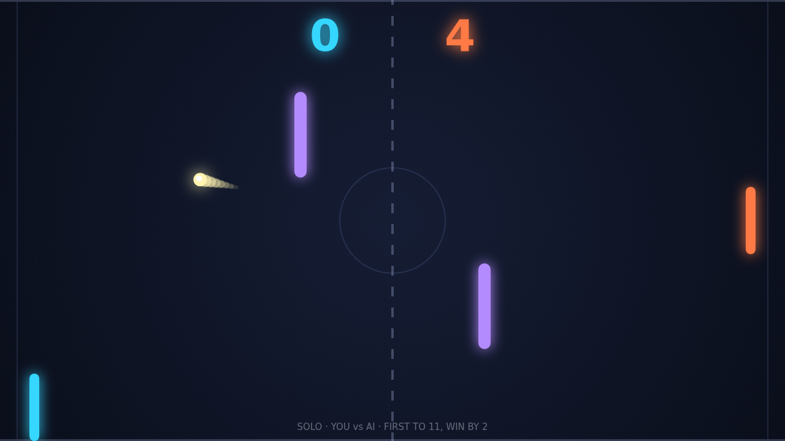

# Carom

Carom is a top-down paddle duel played on one dark, lit table. You hold the
left paddle, your rival holds the right, and a bright ball ricochets between
you, off the top and bottom walls, and off two glowing posts planted mid-field.
Let the ball past you and your opponent takes the point. First to eleven wins,
and you have to win by two, so a tied match at ten-all runs on until someone
breaks it.

The opening rally is a feeling-out. The ball leaves the center at a gentle
angle and comes to the side that was last scored on, and the first returns are
flat and polite. Every paddle hit adds a little pace, though, and within a few
exchanges the ball is a streak with a tail. Where it meets your paddle decides
where it goes next: the center sends it straight back, the ends fire it steeply
toward a wall.

Spin is what makes Carom Carom. Strike the ball while your paddle is moving and
the ball carries that motion with it, bending its flight in the air. A paddle
sweeping downward at contact curls the ball one way, an upward sweep curls it
the other, and the curve eases off as the spin bleeds away. A shot that looks
like it is heading for the middle of your rival's paddle drifts off the end of
it instead, and the trail behind the ball draws the arc for everyone to see.

Then there are the posts. The two bars in mid-field stand just off the center
line, one high on your side and one low on theirs, and a ball that clips one
comes off at a fresh angle with all its speed and spin intact. Played well they
are a weapon: bank a spinning ball off the near post and it arrives from a
direction nobody was covering. Played carelessly they are a hazard, and a return
you thought was safe can rebound straight back at your own goal.

Match point is where the pace tells. By then the ball is close to its top speed,
the rallies are short, and the player who has learned to read the curve has the
edge. Play Solo against an AI that tracks the ball and leans into its returns,
or sit a friend down at the same keyboard for Versus, with W and S on the left
and the arrow keys on the right.
